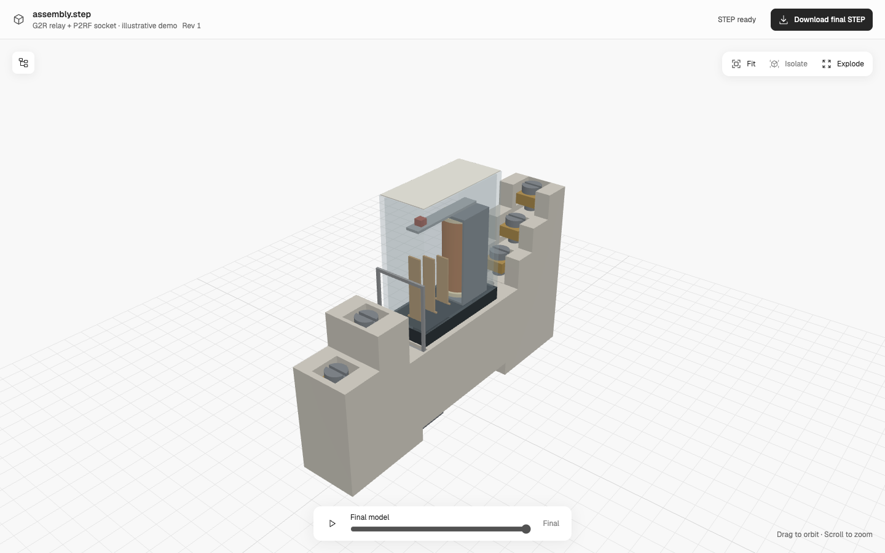

# OpenSkyfall

Rebuild CAD assemblies, part by part, with LLMs and skills.

OpenSkyfall is an independent open-source research project inspired by Skyfall's
assembly workflow. It is not affiliated with, endorsed by, or an official release
of Skyfall AI. It does not include SKY-001 code, weights or API access.



*A native smlibpy demo with 27 placed bodies and 32 saved construction stages.
The internal mechanism is illustrative. The [drawing-fidelity audit](cases/omron-g2r/MANUAL-AUDIT.md)
documents incorrect terminal geometry and omitted features. This is not an
accurate reconstruction or a manufacturing model.*

## What we are building

A lightweight agent skill accepts text, images, STL and manual context. It plans
a physical-part tree, builds each unique part through **smlibpy**, then places
the parts and exports STEP. The conversation manages requirements and evidence.
The side window shows parts, an exploded view, saved construction and the current
STEP download. No project-specific model training is required.

## What works today

| Capability | Current state |
| --- | --- |
| Explainable image decomposition | Agent-authored hierarchy, reusable concept meshes, source regions, parameter bases, actual execution trace, revision bundles, and bounded replay |
| Chat-owned project context and captured change requests | Local HTTP and MCP operations with revision checks |
| Review then native CAD | Explicit proposal/part confirmation, bounded metric Plan conversion through smlibpy, individual parts and placed assembly STEP |
| Lightweight STEP viewer | Part selection, isolation, explosion, construction playback and final download |
| Saved STEP verification | Native readback and separate STEP inspection, with hashes bound to the output |
| Image/text/manual interpretation | Agent-led work; no autonomous reconstruction model in the backend |
| Automated STL fitting | Legacy build123d/OCP path for a bounded mechanical family; not a native smlibpy acceptance result |
| Arbitrary input reconstruction, accurate hidden parts and nested native STEP product trees | Not delivered |
| Real ChatGPT-account integration and lower cost than trained CAD models | Not verified or measured |

Solid validity, source fidelity, physical decomposition and manufacturing
acceptance are separate checks. A valid STEP or an attractive explosion does not
establish the others. See [architecture and limits](docs/design.md).

## Run locally

Install [uv](https://docs.astral.sh/uv/) and Node.js 22 or newer. The main service
uses Python 3.14. Native smlibpy runs in a separate Python 3.12 environment.

```sh
git clone https://github.com/intgral-ai/open-skyfall.git
cd open-skyfall
npm --prefix web ci
npm --prefix web run build
uv sync --frozen

uv venv --python 3.12 .venv-smlib
uv pip install --python .venv-smlib/bin/python -r requirements-native.txt
export OPEN_ASSEMBLY_SMLIB_PYTHON="$PWD/.venv-smlib/bin/python"
uv run --frozen open-skyfall --workspace jobs serve --port 8766
```

Open <http://127.0.0.1:8766/>. The current filesystem runtime uses POSIX file
locking and requires macOS or Linux. Availability of a suitable native wheel
depends on the platform. The public
release check is described in [verification](docs/verification.md).

The home screen opens the anatomy-style workbench. Import an authorized image
and/or description, review the host-authored proposal, inspect exploded parts,
iterate through the host conversation, then explicitly confirm parts for native
conversion. **Explore the inspection rig** opens a labeled designed example with
50 physical parts. It never confirms or builds them automatically. The complete
workflow is documented in [anatomy to CAD](skills/open-skyfall/references/anatomy-to-cad.md).

For the smaller concept-only fixture, import the independently
dimensioned [worktable example](examples/decomposition/worktable/README.md) with
its version 2 explanation plan:

```sh
uv run --frozen open-skyfall --workspace jobs decompose \
  examples/decomposition/worktable/reference.png \
  --rights "Original dimensioned illustration, repository MIT license" \
  --plan examples/decomposition/worktable/plan.json
```

Open `http://127.0.0.1:8766/?project=<returned-id>`. Select a part to inspect its
source regions, dimensions, pose bases, reused definition, and actual execution
trace. New images require the host agent to inspect the source and author a plan.
The backend does not run a vision provider. **Explore the lamp example** retains
the labeled relative-scale legacy illustration with incomplete explanation.

Set `PROJECT` to the returned ID. Export the accepted revision and replay it into
an empty directory:

```sh
curl --fail "http://127.0.0.1:8766/api/decompositions/$PROJECT/bundle" -o bundle.zip
uv run --frozen open-skyfall replay bundle.zip --out empty-replay
```

The bundle preserves source, rights, generated program, preview, actual trace,
and scoped checks with artifact hashes. Replay validates the bundle and rebuilds
through the installed bounded interpreter. It writes `replay-report.json`.
Historical snapshots and bundles remain available through the revision routes.
See [the decomposition workflow](skills/open-skyfall/references/decomposition.md)
for the schema, HTTP/MCP routes, evidence bases, and revision-safe corrections.

Explanation coverage proves documented reasons. Replay proves reproduction
within its declared numerical policy. Neither establishes source fidelity,
native CAD, or manufacturing acceptance. Existing STEP jobs remain available at
`/?job=<id>`.

Concept replay requires the exact recorded engine, Python patch, numpy and
trimesh versions. Keep that application build with the bundle. A replay pass
does not authenticate the bundle's origin; compare its program hash with a
trusted accepted revision or separately retained receipt. Use the installed CLI
to replay archives. See the decomposition reference for the runtime and runner
checks.

To try the bounded native example from another terminal:

```sh
curl --fail http://127.0.0.1:8766/api/native-cases
curl --fail -X POST http://127.0.0.1:8766/api/native-examples \
  -H 'Content-Type: application/json' -d '{"case_id":"wiring-cover"}'
```

The response includes a job ID. Open `http://127.0.0.1:8766/?job=<id>` and wait
for the build. This demonstrates an existing example, not reconstruction of a
new uploaded object. If smlibpy is unavailable, the service reports that state
instead of switching kernels.

The Python module and `open-assembly` CLI remain as compatibility names.

## Use the skill

Read [skills/open-skyfall/SKILL.md](skills/open-skyfall/SKILL.md). A host with local
MCP support can launch the server using [mcp.json](mcp.json):

```sh
uv run --frozen open-skyfall --workspace jobs mcp
```

The tools include `workspace_request`, `show_decomposition`,
`get_decomposition_image`, `show_assembly`, and `get_reference_image`.
Keep project context and editing in the chat. The viewer is for model inspection
and download. MCP packaging alone does not connect a real ChatGPT account;
that requires a compatible host and its deployment configuration.

Manual-driven authoring is demonstrated in [the relay/socket case](cases/omron-g2r/README.md).
The original datasheet and user-supplied CAD files are not distributed. Supply
your own authorized copy to reproduce a case that requires them.

## Contribute

Start with [CONTRIBUTING.md](CONTRIBUTING.md). Useful contributions include
source-to-CAD checks, native part authoring, documented failures and reproducible
examples. [The roadmap](docs/roadmap.md) records the remaining work. No benchmark
in this repository establishes a cost or accuracy advantage over SKY-001.

## License and references

Project-authored source is MIT. Dependencies, fonts and vendored reference skills
keep their own licenses. See [LICENSE](LICENSE), [NOTICES.md](NOTICES.md) and the
[pinned upstream references](references/README.md).

The core native dependency is [smlibpy](https://github.com/awv-informatik/smlibpy).
The workflow also draws on [text-to-cad](https://github.com/earthtojake/text-to-cad)
and [Anatomy](https://github.com/wheresryan22/anatomy). Optional factory intent uses
[Specify](https://github.com/pzfreo/specify-core).
