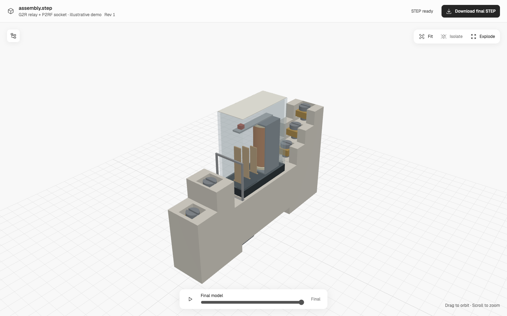

# OpenSkyfall

用 LLM 和 skills 逐件重建 CAD 装配。

这是受 Skyfall 工作流启发的独立开源研究项目，与 Skyfall AI 无隶属或认可关系，
也不包含 SKY-001 的代码、权重或 API。项目内核要求使用 **smlibpy**。

目标是接受文字、图片、STL 和说明书上下文，提出物理零件树，逐件建模后组装并
导出 STEP。项目上下文和修改要求在聊天中管理，侧窗提供零件查看、爆炸、搭建回放
和 STEP 下载。

## 当前状态

本地 HTTP/MCP 项目上下文、捕获修改请求、原生接线盖板示例和 STEP 查看器已实现。
离线继电器案例有 27 个实体实例和 32 个搭建阶段，但端子和安装耳存在复原偏差，
内部结构是示意。[对照审计](cases/omron-g2r/MANUAL-AUDIT.md)保留了这些问题。

任意输入的自动准确复原、完整内部 BOM、嵌套 STEP 产品树和真实 ChatGPT 账户接入
尚未完成或验证。成本优于专用模型的说法也没有实验支持。

几何有效、符合来源、物理零件拆分正确和可制造是不同的验收。我们分别报告结果。

安装和运行请看 [英文 README](README.md#run-locally)。先编译前端，再安装主服务；
主服务使用 Python 3.14，smlibpy 使用单独的 Python 3.12 环境。

入口包括 [Skill](skills/open-skyfall/SKILL.md)、[架构与限制](docs/design.md)、
[路线图](docs/roadmap.md)和[贡献说明](CONTRIBUTING.md)。

项目自有代码采用 MIT。第三方依赖和参考文件保留各自许可证，见 [NOTICES.md](NOTICES.md)。
原始 PDF、用户输入和本地工作记录不随仓库发布。
