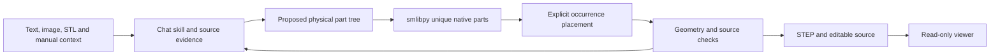

# Architecture and limits

OpenSkyfall uses the chat host's LLM for interpretation and a deterministic CAD
runtime for geometry. The backend does not train a model or call a second LLM.

This diagram describes the target authoring workflow. The current runtime
executes only bounded native examples and an offline authored case; it does not
automatically reconstruct arbitrary source material.

## Responsibilities

The skill manages the goal, constraints, manual excerpts, uncertainty and literal
change requests in the conversation. HTTP/MCP operations persist context and
immutable request captures. Context and geometry have independent revisions.
Capturing a request does not execute geometry.

`runtime/open_assembly/native.py` runs pinned, trusted smlibpy source in a
separate interpreter. Public input cannot choose the source or interpreter.
The registered case supports only the documented wiring-cover parameter range.
`cases/omron-g2r` contains offline native authoring and its failed fidelity audit.

`web/src` renders prepared geometry. It follows one job and offers physical-part
selection, isolation, explosion, saved construction and final STEP download.
Changing a checkpoint never changes the final artifact downloaded. The viewer
has no second context editor or CAD-writing form.

The filesystem store binds artifacts to a geometry revision and hashes.
Stale requests, invalid artifact paths and changed artifact bytes are rejected.
The stdio MCP tools and HTTP operations share the same store behavior.

## Data that must remain separate

- The physical-part tree contains real components and repeated occurrences.
- Construction states describe how each native definition is built.
- Placements describe how instances fit in the product.
- Revision history describes later changes to the model.

An exploded view does not prove that a component is detachable. An authored
construction sequence does not recover the manufacturer's assembly process.

## Acceptance

Native validity, exchange consistency, source fidelity, physical decomposition,
manufacturing intent and host integration receive separate verdicts.

The relay demo passes validity and exchange checks, but fails source fidelity.
Its broad terminal blades and mounting ear were not faithfully reconstructed;
the internal mechanism is illustrative. See its [audit](../cases/omron-g2r/MANUAL-AUDIT.md).

The legacy automated fitter and design builder use
build123d/OCP. Their successful outputs cannot pass the smlibpy construction gate.
An image without scale remains unresolved. Hidden geometry needs evidence or
explicitly labeled assumptions.

The native exporter currently writes flat named B-rep bodies. The JSON document
retains parent groups, unique definitions and occurrence transforms. Do not claim
native nested STEP hierarchy, CAD feature-history transfer or recovered mates.

Optional Specify processing records confirmed manufacturing intent against the
exact geometry hash. Proposed defaults are not factory approval. Any unwritten
PMI or compatibility warning stays in the report. The registered native example
does not accept factory-intent writes.

The backend has no measured advantage over a specialized checkpoint. Compare
accepted reconstructions on the same inputs, evidence and budgets before making
speed, accuracy or cost claims. Real ChatGPT-account integration needs its own
host-side evidence.
