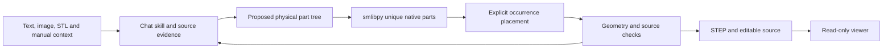

# Architecture and limits

OpenSkyfall uses the chat host's LLM for interpretation and a deterministic CAD
runtime for geometry. The backend does not train a model or call a second LLM.

The runtime executes bounded concept recipes and builds reviewed metric parts
through isolated smlibpy processes. Interpretation stays with the host agent;
the backend does not automatically reconstruct arbitrary source material.

## Explainable image decomposition

`/api/decompositions` stores an authorized image and its SHA256 separately from
CAD jobs. The host model reads the image and submits a bounded concept plan.
Each plan has one assembly root, nested assemblies, reusable geometry definitions,
and placed part occurrences with stable IDs. Positions and Euler XYZ rotations
in degrees are relative to parents in a right-handed Z-up frame. Units remain
relative when metric scale is unknown.

Version 2 plans add stable shape IDs and inline explanation. Source observations
use normalized rectangles on the entire reference image. A shared bases registry
records observed, estimated, assumed, or unknown reasons. Closed address maps
bind every active dimension and local pose component, including default zeros,
to a basis ID. Shape choices, each node's part and placement, and scale also have
bases. Repeated parts share definitions and can share evidence without copying
assumptions. The live `/api/decomposition-schema` is the authoring authority.
Version 1 remains readable with incomplete explanation.

The deterministic preview builder produces separate meshes from boxes,
cylinders, spheres, and hollow rotational shells. It does not execute agent code,
perform image segmentation or produce native BRep. A separate reviewed native
bridge converts metric recipes through smlibpy after explicit part confirmation. The lamp remains a labeled legacy
fixture. The [worktable example](../examples/decomposition/worktable/README.md)
has a version 2 plan authored after inspection of an independent dimensioned
drawing. Neither example substitutes for inspection of a new source.

The renderer applies one whole-assembly center and scale, preserving ratios and
placements. Hierarchy depth changes selection groups, isolation affects a whole
subtree, and explosion is a display translation derived from original bounds.
Restore applies zero offsets exactly. Labels can change without changing IDs.
The inspector shows the selected part's bases, source regions, parameter values,
definition reuse, actual execution trace, and scoped checks. It refuses mismatched
project, revision, program, or runtime bindings. The viewer polls accepted
revisions and retains its camera through geometry changes.

Each accepted revision contains one generated bounded program. Its runtime
identity records the recipe, builder source hash, and Python, numpy, and trimesh
versions. The interpreter emits trace steps as it creates shapes, transforms
them, concatenates definitions, places occurrences, and computes display
normalization. The trace describes actual operations and is not executable input.

An update stages the complete revision and atomically publishes its current
pointer after the revision directory is complete. Accepted history retains record
digests and artifact hashes. Stale or failed writes cannot change accepted
snapshots. Historical reads verify retained records and artifacts.
`GET /api/decompositions/{id}/bundle` exports the current immutable revision.
`GET /api/decompositions/{id}/revisions/{n}` reads a historical snapshot, and its
`/bundle` route exports that revision.

The bundle preserves source bytes, reference image, rights, program, preview,
actual trace, checks, and a hash manifest. The installed command
`open-skyfall replay BUNDLE.zip --out EMPTY_DIRECTORY` validates the archive,
hashes, schema, and runtime before rebuilding through the bounded interpreter.
It never executes code supplied by an archive. The replay report binds its
verdict to the revision, program, runtime, and artifact identities. Identities and
indices compare exactly. Raw vertices, bounds, and normalization compare with
`rtol=0` and `atol=1e-9` in the declared units. Hash equality is a separate check.

Explanation coverage checks the completeness of documented reasons, not their
truth. Mesh checks cover finite indexed nondegenerate triangles and independent
part count, not collision freedom or boolean validity. Replay is initially
unchecked and receives evidence from a separate run. Source fidelity, native CAD,
and manufacturing stay unchecked without their own validation. A reproducible
concept can still be an incorrect interpretation.

The home page and `?project=<id>` inspect concepts. `?job=<id>` and the existing
MCP STEP resource preserve the native CAD inspection workflow. Both keep input,
planning, and corrections in the conversation, with no additional chat composer.

## Responsibilities

The skill manages the goal, constraints, manual excerpts, uncertainty and literal
change requests in the conversation. HTTP/MCP operations persist context and
immutable request captures. Context and geometry have independent revisions.
Capturing a request does not execute geometry.

`runtime/open_assembly/native.py` runs pinned, trusted smlibpy source in a
separate interpreter. Public input cannot choose the source or interpreter.
The registered case supports only the documented wiring-cover parameter range.
`cases/omron-g2r` contains offline native authoring and its failed fidelity audit.

`web/src` renders prepared geometry. It follows one job and offers physical-part
selection, isolation, explosion, saved construction and final STEP download.
Changing a checkpoint never changes the final artifact downloaded. The viewer
has no second context editor or CAD-writing form.

The filesystem store binds artifacts to a geometry revision and hashes.
Stale requests, invalid artifact paths and changed artifact bytes are rejected.
The stdio MCP tools and HTTP operations share the same store behavior.

## Data that must remain separate

- The physical-part tree contains real components and repeated occurrences.
- Construction states describe how each native definition is built.
- Placements describe how instances fit in the product.
- Revision history describes later changes to the model.

An exploded view does not prove that a component is detachable. An authored
construction sequence does not recover the manufacturer's assembly process.

## Acceptance

Native validity, exchange consistency, source fidelity, physical decomposition,
manufacturing intent and host integration receive separate verdicts.

The relay demo passes validity and exchange checks, but fails source fidelity.
Its broad terminal blades and mounting ear were not faithfully reconstructed;
the internal mechanism is illustrative. See its [audit](../cases/omron-g2r/MANUAL-AUDIT.md).

The legacy automated fitter and design builder use
build123d/OCP. Their successful outputs cannot pass the smlibpy construction gate.
An image without scale remains unresolved. Hidden geometry needs evidence or
explicitly labeled assumptions.

The native exporter currently writes flat named B-rep bodies. The JSON document
retains parent groups, unique definitions and occurrence transforms. Do not claim
native nested STEP hierarchy, CAD feature-history transfer or recovered mates.

Optional Specify processing records confirmed manufacturing intent against the
exact geometry hash. Proposed defaults are not factory approval. Any unwritten
PMI or compatibility warning stays in the report. The registered native example
does not accept factory-intent writes.

The backend has no measured advantage over a specialized checkpoint. Compare
accepted reconstructions on the same inputs, evidence and budgets before making
speed, accuracy or cost claims. Real ChatGPT-account integration needs its own
host-side evidence.

## Anatomy-style iteration and native conversion

The decomposition viewer accepts an authorized image, literal description, or
both. Text-only projects retain the original UTF-8 bytes and hash without an
invented image. Programs preserve a hashed literal brief. Text observations must
quote that brief; image observations reference the actual normalized source.

A saved proposal precedes geometry in the staged workflow. It describes the
physical hierarchy, unknowns and manufacturing considerations. The operator
confirms that proposal before the host authors a detailed concept Plan. The
inspection-rig fixture has a separate explicit decomposition action and remains
labeled as an authored design example. No uploaded source is replaced by it.

`workflow_revision` tracks proposal, captured requests, explicit confirmations
and native build state independently of immutable concept `revision`. The same
project lock protects both. Each part review digest includes source, brief,
physical definition, relevant explanation, proposed manufacturing notes and its
full ancestor placement chain. A group digest binds its exact physical members.
Accepted geometry does not establish human confirmation. Changes invalidate
affected confirmations; unchanged parts retain theirs. A captured change expands
a shared definition to all affected occurrences and blocks their confirmation
until the host applies the request. Original text and revision bindings persist.

The viewer uses anatomy's restrained solid shading, orthographic framing and
calm display motion. Explosion offsets never change model coordinates. Source
intake and explicit confirmation/conversion are user actions. Iteration prose
stays in the host conversation. A supported embedded host may accept the clicked
selection as a message; a standalone clipboard handoff is labeled as a copy.
Real host-account delivery remains a separate integration check.

Native conversion requires metric scale and current explicit confirmations for
the selected physical scope. A trusted bounded runner builds each unique
definition once, with at most two independent native processes. It fuses locally
posed primitives into one valid connected positive-volume solid per definition,
then places copies using composed parent transforms. Disconnected recipes fail.
The assembler exports individual STEP/SMB, the placed assembly STEP, a native
mesh preview, actual construction traces and a physical-tree manifest. It checks
names, body counts, volumes and bounds by reading STEP with healing disabled.
The result preserves source, concept program, review and runtime identities.
Publication rechecks the current Plan and confirmations after construction; a
stale or failed build cannot become the current STEP download.

The installed exporter writes flat named placed BRep bodies. Parent groups,
reusable definitions and transforms remain in `assembly.json`; native STEP
product hierarchy, mates and transferred feature history are not established.
A valid solid and STEP readback do not establish source fidelity, collision
freedom, interface tolerances or factory manufacturability. Process, material,
critical features and machining notes are proposals pending actual requirements.
