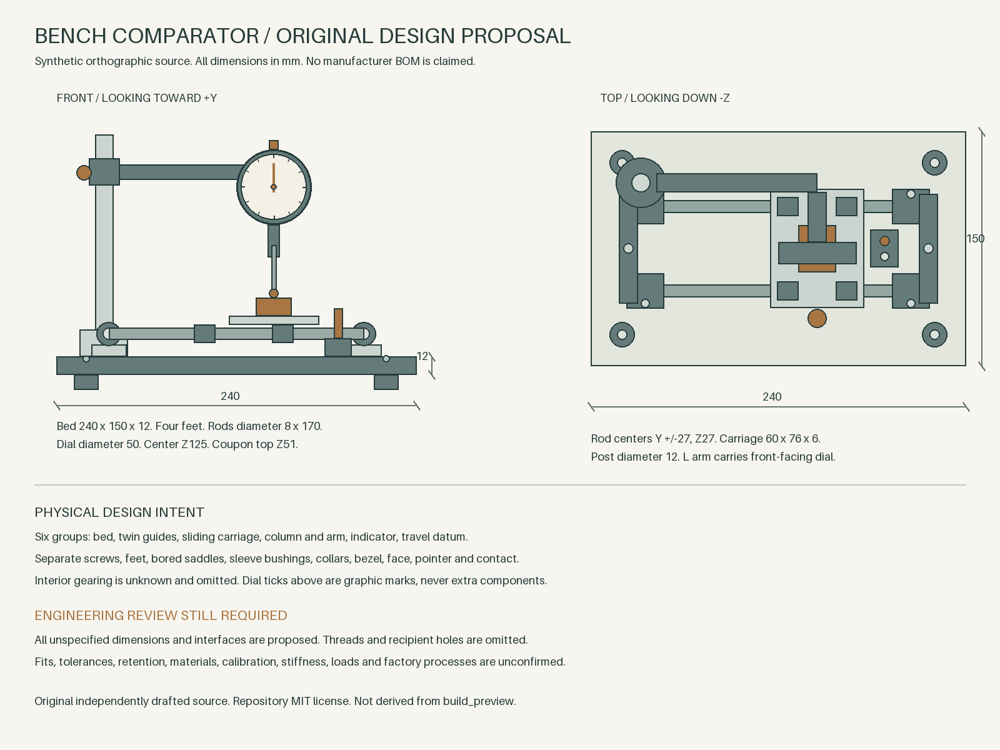

# Bench comparator design example

This is an original proposed instrument design. It is not an inferred
manufacturer BOM, a calibrated comparator or a manufacturing release.
`reference.png` is an independently drafted orthographic illustration, made
with direct 2D drawing commands rather than `build_preview`. `brief.txt` retains
the literal designed requirements. Both are shareable under the repository's
MIT license.

The proposed fixture has **50 physical occurrences, six subassemblies, 26 unique
definitions and 57 total tree nodes**. The bed, twin guide rods, sleeve-bearing
carriage, column and L arm, front-facing dial and travel datum make one
recognizable bench instrument. Every modeled fastener, sleeve, contact and
enclosure component has a mechanical purpose. Dial ticks are drawing graphics,
not invented part occurrences. Repeated screws, feet, saddles, bushings and knobs
reuse their definitions.



`proposal.json` contains the scheme to review before geometry. `plan.json`
contains its millimeter version 2 physical tree, stable IDs, assembled local
poses and complete explanation maps. Every active dimension and local pose
component has a basis. Most detailed choices are explicitly assumed, since an
original design brief does not supply measured product evidence. Each definition
also carries proposed process, material, notes and critical features.

Each definition uses one or two connected primitives. One-piece screws have
overlapping shanks and heads. Saddles fuse a mounting pad to a bored shell.
Bushings, column collar, housing, bezel and stem retain actual bores. The L arm
is one connected body. These recipes are intended for the smlibpy bridge's
single-solid check; this fixture contains no saved approval or native success
report.

The example action creates source and proposal only. Review the scheme and use
the explicit proposal confirmation control before loading its decomposition.
Inspect and explode the resulting parts, issue literal selected-part corrections
in the host conversation, then confirm the current part or subtree digest.
Build a confirmed part before requesting the complete confirmed assembly. The
native report and STEP readback must come from that actual build.

Regenerate the fixture with Python and Pillow.

```sh
python3 examples/decomposition/inspection-rig/build.py
```

The script writes the drawing, literal brief, proposal and plan deterministically.
The source hash in the plan binds the generated PNG bytes. Pillow font/rendering
versions can change PNG bytes, so regenerate and validate the plan together.

Manufacturing remains pending. Threads, drive recesses, recipient mounting and
tapped holes, retaining details and exact purchased-part interfaces are omitted.
Fastener shanks may overlap their solid recipients because the holes are absent.
The dial has an exterior envelope, face and pointer, with no invented internal
gear train. Its drawn graduations are not modeled. Fits, tolerances, calibrated
travel, contact stress, stiffness, loads, finish and factory process need
engineering review. The saved pose is one stationary inspection pose and does
not establish collision-free travel. Native validity, STEP exchange, source
fidelity and manufacturing each need their own verdict.

Use the [anatomy-to-CAD authoring reference](../../../skills/open-skyfall/references/anatomy-to-cad.md)
and [verification journey](../../../.agents/skills/verify/features/anatomy-to-cad.md)
for the complete intake, iteration, confirmation and native delivery sequence.
